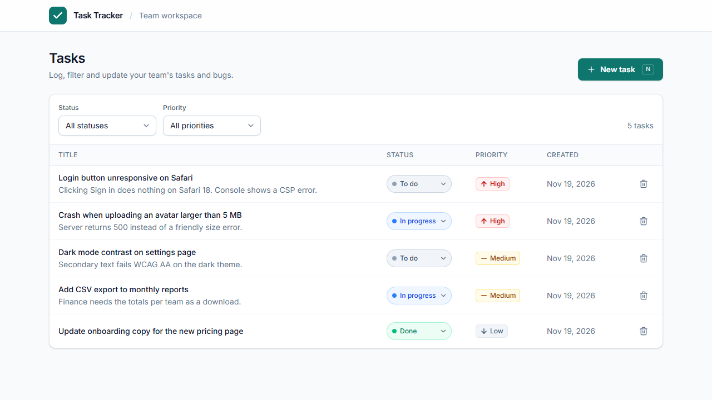
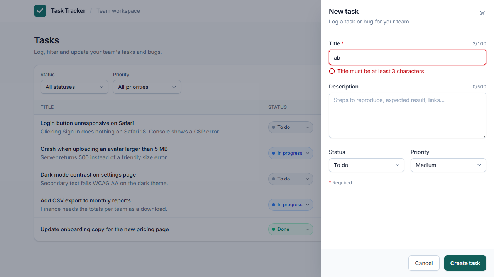

# Team Task & Bug Tracker

A lightweight full-stack tracker where team members log tasks or bugs, filter them by status or
priority, update their status, and delete them. It's built with MongoDB, Express, React and
Node.js, all in strict TypeScript.





## Tech stack

| Layer | Tools |
|---|---|
| API | Node.js, Express 5, Mongoose 9 (MongoDB), TypeScript (strict) |
| Validation | Zod 4. The same schemas are shared by the API and the UI. |
| Tests | Vitest + Supertest + mongodb-memory-server |
| UI | React 19, Vite 8, Tailwind CSS 4, lucide-react icons |
| Tooling | npm workspaces, ESLint (typescript-eslint, `no-explicit-any` = error) |

## Project structure

```
shared/   Zod schemas, enums and inferred types: the single source of truth for both sides
server/   Express API
  src/app.ts             createApp() (no listen), used by the tests
  src/server.ts          connect to MongoDB + listen + graceful shutdown
  src/index.ts           entry: validated env → startServer
  src/dev-memory.ts      dev entry with a throwaway in-memory MongoDB
  src/config/env.ts      Zod-validated environment variables
  src/models/            Mongoose model + toTaskDto (API shape: id, ISO dates)
  src/controllers/       request handlers
  src/routes/            /api/tasks router
  src/middleware/        central error handler, 404 handler
  tests/                 API tests (Supertest, in-memory MongoDB)
client/   React single-page app
  src/api/tasks.ts       the only fetch caller; validates every response with the shared schemas
  src/hooks/useTasks.ts  list state, server-side filters, mutations
  src/components/        table, toolbar, status select, badges, drawer, form, toasts
```

**How type safety works end to end:** `shared/src/task.ts` defines the Zod schemas once. The API
validates requests with them. The UI validates the form and parses every API response with them.
All `Task` / input types come from `z.infer`, so neither side redefines a type or a rule.

## Prerequisites

- Node.js 22.13+ or 24+ (developed on Node 24). Vitest 5 and ESLint 10 need at least this.
- For `npm run dev`: a MongoDB database, either local `mongod` or a free
  [MongoDB Atlas](https://www.mongodb.com/atlas) cluster. Neither `npm test` nor `npm run dev:memory`
  needs one.

## Setup

```bash
git clone <this-repo-url> task-tracker
cd task-tracker
npm install
cp server/.env.example server/.env    # then set MONGODB_URI
```

Environment variables (`server/.env`):

| Variable | Required | Default | Description |
|---|---|---|---|
| `PORT` | no | `4000` | Port the API listens on |
| `MONGODB_URI` | yes | (none) | `mongodb://…` or `mongodb+srv://…` connection string |

The API checks these at startup. If `MONGODB_URI` is missing or malformed, it stops with a clear message.

## Running

```bash
npm run dev          # API on http://localhost:4000 + UI on http://localhost:5173
npm run dev:memory   # same, but with a temporary in-memory MongoDB (no setup; data resets on restart)
```

Open http://localhost:5173. Vite proxies `/api` to the API on the same `PORT` (read from the shell or
`server/.env`), so the UI needs no configuration.
Press <kbd>N</kbd> anywhere on the page to open the "New task" panel.

## Tests and checks

```bash
npm test             # API, schema and client API-module tests (Vitest)
npm run typecheck    # tsc --noEmit for every workspace
npm run lint         # ESLint (type-aware)
npm run build        # production build of the UI
```

The tests start their own in-memory MongoDB, so no database is needed. **The first run downloads a
MongoDB binary (about 800 MB).** It's cached after that.

Coverage includes:
- **POST:** 201 with saved fields and defaults. 400 with field errors for a missing, too-short or
  whitespace-only title. 400 for malformed JSON.
- **GET:** newest first, filtering by `status`, `priority` and both. 400 for an invalid filter.
- **PATCH:** status and priority updates are persisted. 404 for unknown and malformed ids. 400 for an
  empty body, a `title` change or an invalid status.
- **DELETE:** 200 confirmation, then the task is gone. 404 for unknown and malformed ids.
- **Schemas:** length boundaries (3/100 title, 500 description), trimming, unknown keys rejected.
- **Env:** default port, missing or invalid variables.

## API

Base URL: `/api`. Responses use `id` (string) and ISO-8601 dates.

| Method | Path | Body / query | Success | Errors |
|---|---|---|---|---|
| GET | `/tasks` | `?status=todo\|in_progress\|done&priority=low\|medium\|high` (both optional) | `200 Task[]`, newest first | `400` invalid filter |
| POST | `/tasks` | `{ title, description?, status?, priority? }` | `201 Task` | `400` validation |
| PATCH | `/tasks/:id` | `{ status?, priority? }` (at least one) | `200 Task` | `400` validation · `404` unknown **or malformed** id |
| DELETE | `/tasks/:id` | (none) | `200 { message: "Task deleted", id }` | `404` unknown or malformed id |

Rules: `title` is trimmed, 3–100 characters. `description` is at most 500 characters.
`status` defaults to `todo` and `priority` to `medium`. Unknown fields are rejected.

Every error has the same shape:

```json
{
  "message": "Validation failed",
  "errors": [{ "field": "title", "message": "Title must be at least 3 characters" }]
}
```

`errors` is present only for validation failures.

## Trade-offs (3-hour time box)

1. **Refetch after every change instead of a cache library.** A status change shows in the row right
   away, and the list is refetched after every create, update or delete. If a save fails, the refetch
   puts the row back. That costs one extra request, but the list always matches the server-side
   filters. For example, a task moved to "Done" leaves a "To do" view, with no client-side filter logic
   to keep in sync. A library like TanStack Query would add caching and finer-grained updates, but
   also more code to explain.
2. **Few frontend automated tests.** The brief asks for API tests, so the time went into those plus
   strict typing. On the client, only the API module has unit tests (aborts, unexpected responses).
   Every UI flow was checked by hand in a real browser (Playwright) at desktop and phone width:
   create, validation errors, filters, status change, delete, empty, loading and error states,
   keyboard-only use, reduced motion. Next step: React Testing Library tests for the form, plus a
   Playwright end-to-end run in CI.

Smaller choices:
- The shared package is consumed as TypeScript source, and the API runs through `tsx`. There's no
  compile step for the server, which keeps the setup simple. A production build would add a `tsc`
  emit step.
- There's no pagination. The list returns every matching task.

## With more time

- Pagination, plus sorting by priority or date
- Editing a task's title and description
- Frontend tests (React Testing Library) and Playwright e2e in CI
- Docker Compose for MongoDB + API + UI
