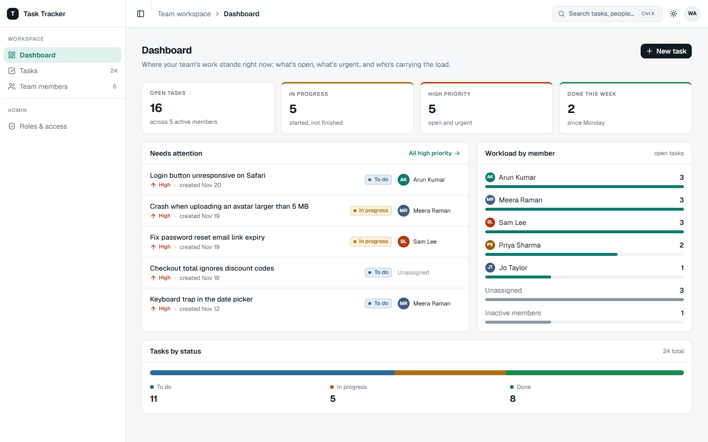
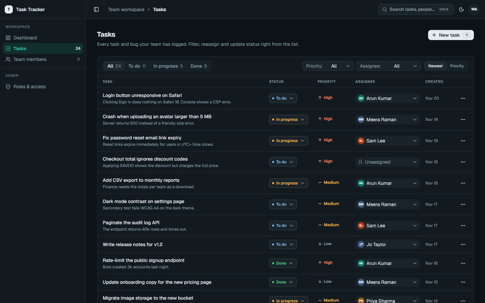
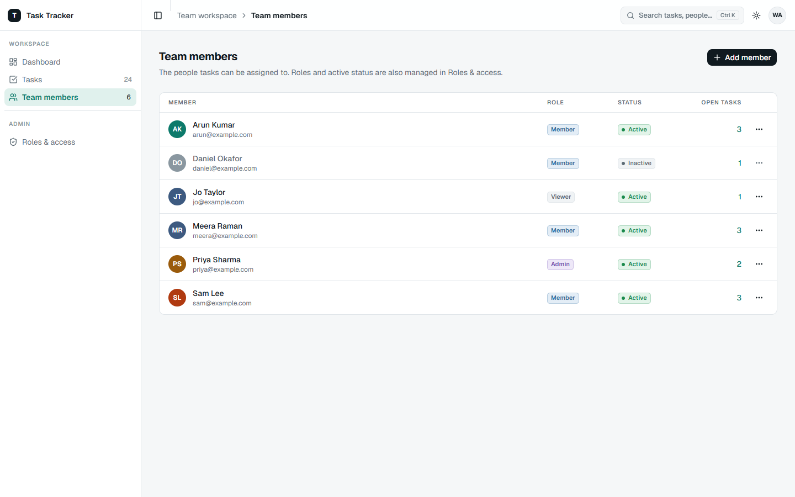

# Task Tracker

A full-stack team task and bug tracker: a dashboard, a task list you can filter, update and
reassign, team management, and roles. It's built with MongoDB, Express, React and Node.js, all in
strict TypeScript.

> **Two versions live in this repo.**
> - `main` is the **minimal submission**: exactly what the take-home brief asks for (one page with the four REST endpoints).
> - `feature/full-app` (this branch) builds a **complete application** on top of it, without changing the brief's API contract.



| Tasks (dark mode) | Team members |
|---|---|
|  |  |

## What's in it

- **App shell:** a sidebar that collapses to an icon rail (button or <kbd>Ctrl</kbd>+<kbd>B</kbd>,
  remembered), a light/dark/system theme (remembered, with no flash on load), and a
  <kbd>Ctrl</kbd>+<kbd>K</kbd> command palette that jumps to pages, tasks and people.
- **Dashboard:** open, in-progress, high-priority and done-this-week counts. Also a "Needs
  attention" list, workload per member and tasks by status. Everything links to the filtered task list.
- **Tasks:**
  - Status tabs with counts, plus priority and assignee filters. Filtering happens on the server,
    and the filters are kept in the URL.
  - Sort by newest or priority.
  - Change status inline (it updates immediately and rolls back if the save fails), reassign, and
    delete with a confirmation.
  - Press <kbd>N</kbd> anywhere for **New task**.
- **Team members:** add, edit, deactivate and reactivate people. Emails are unique regardless of
  case, and each member shows an open-task count.
- **Roles & access:** change roles (Admin / Member / Viewer) and active status. The last active
  admin can't be removed.
- Loading, empty and error states on every page, toasts for every change, keyboard support, and
  a layout that works from phones to wide screens.

## Tech stack

| Layer | Tools |
|---|---|
| API | Node.js, Express 5, Mongoose 9 (MongoDB), TypeScript (strict) |
| Validation | Zod 4: **one set of schemas shared by the API and the UI** |
| Tests | Vitest + Supertest + mongodb-memory-server |
| UI | React 19, Vite 8, Tailwind CSS 4, **shadcn/ui (Radix)**, React Router 7, TanStack Query 5, Geist font, lucide icons |
| Tooling | npm workspaces, ESLint (type-aware, `no-explicit-any` = error) |

## Project structure

```
shared/   Zod schemas + inferred types (task, member, dashboard): the single source of truth
server/   Express API
  src/app.ts            createApp() (no listen), used by the tests
  src/server.ts         connect + listen + graceful shutdown (fails fast if the port is taken)
  src/controllers/      tasks, members, dashboard
  src/models/           Mongoose models + DTO mappers (id, ISO dates)
  src/seed/             sample data + `npm run seed`
  tests/                API tests against an in-memory MongoDB
client/   React app
  src/api/              the only fetch callers; every response validated with the shared schemas
  src/components/ui     shadcn/ui components
  src/components/layout sidebar, top bar, theme switch, command palette
  src/features/         dashboard, tasks, team, roles (page + pieces + data hooks)
```

The `Task` and `Member` types and every validation rule are defined once in `shared/`. The API
validates requests with them, and the UI validates forms and parses every response with them.
Neither side redefines a type.

## Prerequisites

- Node.js 22.13+ or 24+ (Vitest 5 and ESLint 10 need it)
- For `npm run dev`: a MongoDB database, either local `mongod` or a free
  [MongoDB Atlas](https://www.mongodb.com/atlas) cluster. `npm test` and `npm run dev:memory` need no database.

## Setup and running

```bash
npm install
cp server/.env.example server/.env    # set MONGODB_URI

npm run dev:memory   # quickest: temporary in-memory MongoDB, pre-filled with sample data
npm run dev          # API on :4000 + UI on :5173 against MONGODB_URI
```

Open http://localhost:5173. Vite proxies `/api` to the API on the same `PORT` (read from the
shell or `server/.env`).

**Sample data for a real database:**

```bash
npm run seed               # adds 6 members and 24 tasks, only if tasks and members are empty
npm run seed -- --force    # DELETES all tasks and members in that database, then reseeds
```

The seed prints the database name and host before it writes anything.

| Variable | Required | Default | Description |
|---|---|---|---|
| `PORT` | no | `4000` | API port (the UI proxy follows it) |
| `MONGODB_URI` | yes | (none) | `mongodb://…` or `mongodb+srv://…` |

## Tests and checks

```bash
npm test             # shared schemas, API, and client API-module tests (Vitest)
npm run typecheck    # tsc --noEmit for every workspace
npm run lint         # ESLint (type-aware)
npm run build        # production build of the UI
```

The tests start their own in-memory MongoDB. **The first run downloads a MongoDB binary (about
800 MB),** which is cached after that. The suite covers:
- every endpoint's success and error paths (400, 404, 409)
- the last-admin guard and email normalization
- assignment rules (inactive or unknown members are rejected)
- `completedAt`, dashboard maths including the week boundary
- seeding, which refuses without `--force` and leaves other collections alone
- client request building and response validation

## API

Base URL `/api`. Responses use `id` (string) and ISO-8601 dates.

**From the brief (unchanged contract):**

| Method | Path | Body / query | Success | Errors |
|---|---|---|---|---|
| GET | `/tasks` | `?status=` `?priority=` `?assigneeId=<id>\|unassigned` | `200 Task[]` newest first | `400` |
| POST | `/tasks` | `{ title, description?, status?, priority?, assigneeId? }` | `201 Task` | `400` |
| PATCH | `/tasks/:id` | `{ status?, priority? }` (at least one, **nothing else**) | `200 Task` | `400` · `404` unknown **or malformed** id |
| DELETE | `/tasks/:id` | (none) | `200 { message, id }` | `404` |

**Added in this version:**

| Method | Path | Body / query | Success | Errors |
|---|---|---|---|---|
| PATCH | `/tasks/:id/assignee` | `{ assigneeId: string \| null }` | `200 Task` | `400` inactive or unknown member · `404` |
| GET | `/members` | `?status=` `?role=` | `200 Member[]` (with `openTaskCount`) | `400` |
| POST | `/members` | `{ name, email, role? }` | `201 Member` | `400` · `409` email taken |
| PATCH | `/members/:id` | `{ name?, email?, role?, status? }` | `200 Member` | `400` (incl. last active admin) · `404` · `409` |
| GET | `/dashboard/summary` | (none) | `200 { totals, byStatus, byPriority, workload, needsAttention }` | (none) |

Every error has the same shape. `errors` appears for field-level problems:

```json
{ "message": "Validation failed", "errors": [{ "field": "title", "message": "Title must be at least 3 characters" }] }
```

## Design decisions and trade-offs

1. **No sign-in, by design.** Roles are descriptive labels and are not enforced. Adding auth would
   put a token on every request and break the brief's endpoints for anyone testing them as
   specified. The data model and API are ready for an auth layer later.
2. **Reassignment has its own endpoint.** `PATCH /tasks/:id` still accepts only status and priority,
   exactly as the brief specifies. Assignment is a separate concern with its own validation
   (active member only).
3. **TanStack Query instead of hand-written fetching.** v1 refetched manually. With several pages
   sharing data, a cache with invalidation is simpler and keeps the sidebar counts, dashboard and
   lists in sync. Status changes update immediately and roll back on failure.
4. **Deactivate, never delete, members.** This keeps task history and assignments intact.
5. **Few frontend unit tests.** The time went into API tests and strict typing. Every UI flow was
   verified in a real browser (Playwright) in light and dark at desktop and phone width.
   Next step: React Testing Library for the forms, plus a Playwright e2e run in CI.

## With more time

- Sign-in with enforced roles
- Editing task title and description, comments, due dates
- Pagination and full-text search on the server
- Frontend component tests and an e2e suite in CI, plus Docker Compose for the whole stack
